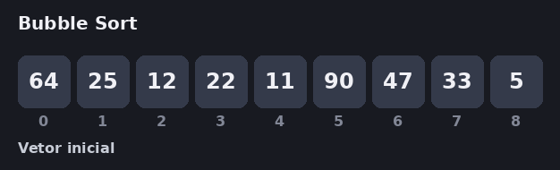
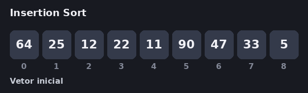

# 🔢 Algoritmos de Ordenação

**Veja cada algoritmo ordenar, passo a passo, com números.**

Todas as animações usam o mesmo vetor de entrada:

`[64, 25, 12, 22, 11, 90, 47, 33, 5]`

---

## 📑 Sumário

- [Comparativo rápido](#comparativo-rápido)
- [Quick sort](#quick-sort)
- [Selection sort](#selection-sort)
- [Bubble sort](#bubble-sort)
- [Insertion sort](#insertion-sort)

---

## Comparativo rápido

| Algoritmo | Melhor caso | Caso médio | Pior caso | Espaço extra | Estável |
|:---|:---:|:---:|:---:|:---:|:---:|
| **Quick sort** | O(n log n) | O(n log n) | O(n²) | O(log n) | ❌ |
| **Selection sort** | O(n²) | O(n²) | O(n²) | O(1) | ❌ |
| **Bubble sort** | O(n) | O(n²) | O(n²) | O(1) | ✅ |
| **Insertion sort** | O(n) | O(n²) | O(n²) | O(1) | ✅ |

---

## Quick sort

> ⚡ *Divide e conquista: o pivô vai direto para o lugar definitivo.*

Escolhe um elemento como pivô e reorganiza o vetor em duas zonas: todos os elementos menores ou iguais ao pivô ficam à esquerda, e todos os maiores ficam à direita. Ao final da varredura, o pivô é trocado e fica fixado na sua posição definitiva, dividindo o vetor para as chamadas recursivas seguintes. Na animação, o pivô é sempre o último elemento da faixa.

| Melhor | Médio | Pior |
|:---:|:---:|:---:|
| $O(N \log N)$ | $O(N \log N)$ | $O(N^2)$ |

  

<a href="#-sumário">⬆ voltar ao sumário</a>

---

## Selection sort

> 🎯 *Sempre procura o menor e coloca na frente.*

Percorre o trecho não ordenado do vetor até encontrar o menor elemento e o coloca na posição inicial correspondente, fazendo apenas uma troca por passagem, repetindo o processo até que tudo esteja ordenado.

| Melhor | Médio | Pior |
|:---:|:---:|:---:|
| $O(N^2)$ | $O(N^2)$ | $O(N^2)$ |

  

<a href="#-sumário">⬆ voltar ao sumário</a>

---

## Bubble sort

> 🫧 *Os maiores valores sobem como bolhas até o final.*

Percorre o vetor comparando elementos vizinhos um a um. Se o elemento de trás for maior que o da frente ($v[j] > v[j + 1]$), realiza a troca para empurrar os maiores valores para o final.

| Melhor | Médio | Pior |
|:---:|:---:|:---:|
| $O(N)$ *(com flag de parada)* | $O(N^2)$ | $O(N^2)$ |

  

<a href="#-sumário">⬆ voltar ao sumário</a>

---

## Insertion sort

> 🃏 *Como organizar cartas na mão: uma por vez, no lugar certo.*

Constrói a ordenação aos poucos. Pega um número por vez, compara com os elementos de trás (já ordenados à esquerda) e desloca os maiores para a direita até encaixá-lo no lugar certo. Só segue em frente quando todos os de trás estiverem ordenados.

| Melhor | Médio | Pior |
|:---:|:---:|:---:|
| $O(N)$ *(vetor já ordenado)* | $O(N^2)$ | $O(N^2)$ *(ordem inversa)* |

  

<a href="#-sumário">⬆ voltar ao sumário</a>

---

## Legenda das cores

| Cor | Nome | Significado | Aparece em |
|:---:|:---|:---|:---|
| ⬛ | Cinza | Elemento ainda não visitado | Todos |
| 🟨 | Amarelo | Elemento sendo comparado | Todos |
| 🟥 | Vermelho | Elementos sendo trocados | Todos |
| 🟩 | Verde | Elemento já na posição final | Todos |
| 🟦 | Azul | Menor valor encontrado até agora | Selection sort |
| 🟧 | Laranja | Posição `i`, onde entra o próximo valor menor que o pivô | Quick sort |
| 🟪 | Roxo | Pivô (Quick sort) ou elemento que está sendo inserido (Insertion sort) | Quick sort e Insertion sort |
| 🟢 | Verde escuro | Parte já ordenada, mas ainda sujeita a deslocamento | Insertion sort |