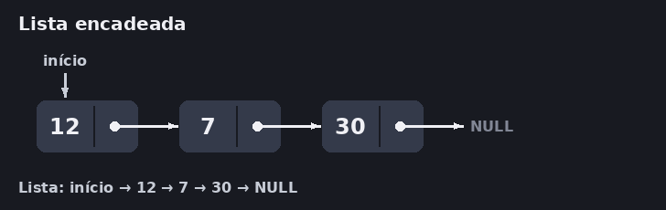
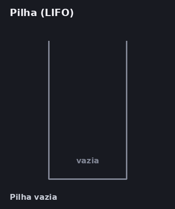
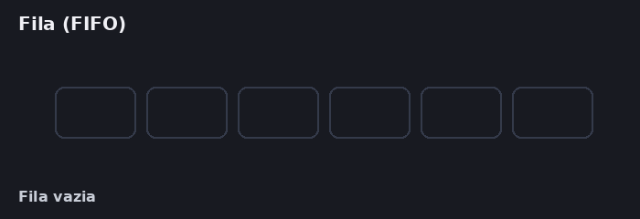
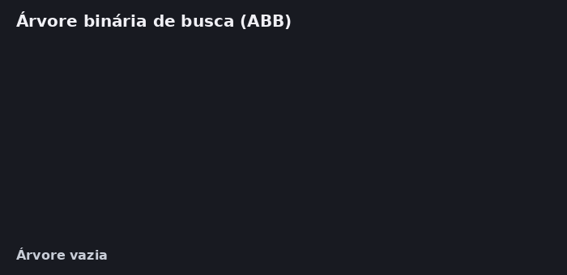

# 📚 Estruturas de Dados

**Guia rápido e visual: regras de funcionamento, operações básicas e complexidade (Big-O).**

---

## 📑 Sumário

- [1. Lista (List)](#1-lista-list)
- [2. Pilha (Stack)](#2-pilha-stack)
- [3. Fila (Queue)](#3-fila-queue)
- [4. Árvore (Tree)](#4-árvore-tree)
- [Tabela comparativa rápida](#-tabela-comparativa-rápida)
- [Legenda das cores](#legenda-das-cores)
- [Gerando as animações](#gerando-as-animações)

---

## 1. Lista (List)

> 🔗 *Nós ligados por ponteiros: fácil de inserir no início, mas para achar alguém é preciso andar nó por nó.*

Uma coleção linear de elementos onde não há uma restrição rígida de onde inserir ou remover (pode ser no início, no meio ou no fim).

**Tipos principais**

- **Estática (Vetor/Array):** os elementos ficam em blocos contíguos na memória RAM. Acesso direto pelo índice em $O(1)$, mas tamanho fixo e inserções/remoções no meio exigem deslocar elementos.
- **Dinâmica (Lista Encadeada):** cada elemento é um **nó** alocado dinamicamente contendo o dado e um ponteiro para o próximo nó (`proximo`). Não exige memória contígua, mas para achar um elemento é preciso percorrer nó por nó.

**Complexidade (Lista Encadeada)**

| Operação | Custo |
|:---|:---:|
| Acesso / Busca | $O(N)$ |
| Inserção / Remoção no início | $O(1)$ |
| Inserção / Remoção no meio ou fim | $O(N)$ *(ou $O(1)$ se já tiver o ponteiro para o local)* |

  

<a href="#-sumário">⬆ voltar ao sumário</a>

---

## 2. Pilha (Stack)

> 🍽️ *Como uma pilha de pratos: o último que entrou é o primeiro que sai.*

Estrutura linear que segue rigorosamente a regra **LIFO** (*Last-In, First-Out*: o último a entrar é o primeiro a sair).

**Funcionamento:** todas as operações acontecem exclusivamente em uma única extremidade chamada **Topo**.

**Operações principais**

| Operação | O que faz |
|:---|:---|
| `push` (Empilhar) | Insere um elemento no topo |
| `pop` (Desempilhar) | Remove e retorna o elemento do topo |
| `peek` / `top` | Apenas consulta quem está no topo, sem remover |

**Exemplos de uso:** controle de chamadas de funções (Call Stack / recursão), botão "Desfazer" (`Ctrl + Z`), navegação de histórico.

**Complexidade**

| Operação | Custo |
|:---|:---:|
| Inserção (`push`) | $O(1)$ |
| Remoção (`pop`) | $O(1)$ |
| Busca | $O(N)$ |

  

<a href="#-sumário">⬆ voltar ao sumário</a>

---

## 3. Fila (Queue)

> 🏦 *Como uma fila de banco: quem chegou primeiro é atendido primeiro.*

Estrutura linear que segue rigorosamente a regra **FIFO** (*First-In, First-Out*: o primeiro a entrar é o primeiro a sair).

**Funcionamento:** possui duas extremidades distintas: os elementos entram pelo **Fim** (cauda) e saem pelo **Início** (cabeça).

**Operações principais**

| Operação | O que faz |
|:---|:---|
| `enqueue` (Enfileirar) | Adiciona um elemento no final da fila |
| `dequeue` (Desenfileirar) | Remove e retorna o elemento do início da fila |
| `front` | Apenas consulta quem é o primeiro da fila |

**Exemplos de uso:** fila de impressão, gerenciamento de processos no sistema operacional, atendimento por ordem de chegada.

**Complexidade**

| Operação | Custo |
|:---|:---:|
| Inserção (`enqueue`) | $O(1)$ |
| Remoção (`dequeue`) | $O(1)$ |
| Busca | $O(N)$ |

  

<a href="#-sumário">⬆ voltar ao sumário</a>

---

## 4. Árvore (Tree)

> 🌳 *Hierarquia sem ciclos: a cada passo da busca, metade dos caminhos é descartada.*

Estrutura de dados **não-linear e hierárquica**, organizada em nós conectados por arestas, sem ciclos.

**Conceitos básicos**

- **Raiz (Root):** o nó principal no topo da hierarquia.
- **Nós Internos / Filhos:** nós intermediários que possuem subárvores à esquerda e/ou à direita.
- **Folhas (Leaves):** nós nas extremidades finais que não possuem filhos (`NULL`).
- **Altura:** distância (número de degraus) da folha mais profunda até o nó.

**Principais variações**

- **Árvore Binária de Busca (ABB):** para cada nó, valores **menores** ficam na subárvore à **esquerda** e valores **maiores** ficam à **direita**. Busca média em $O(\log N)$, mas se os dados entrarem já ordenados, degenera em uma lista encadeada e cai para $O(N)$.
- **Árvore AVL (Autobalanceada):** monitora a altura dos nós e realiza **rotações** automáticas a cada inserção para garantir que a diferença de altura entre os lados nunca passe de 1, assegurando $O(\log N)$ em **todos** os cenários.

**Complexidade (ABB Balanceada / AVL)**

| Operação | Custo |
|:---|:---:|
| Busca | $O(\log N)$ *(melhor caso: $O(1)$ na raiz)* |
| Inserção | $O(\log N)$ |
| Remoção | $O(\log N)$ |

  

<a href="#-sumário">⬆ voltar ao sumário</a>

---

## 📊 Tabela Comparativa Rápida

| Estrutura | Regra / Organização | Inserção | Remoção | Busca |
| :--- | :--- | :---: | :---: | :---: |
| **Lista Encadeada** | Livre (nós ligados por ponteiros) | $O(1)$ *(início)* / $O(N)$ | $O(1)$ *(início)* / $O(N)$ | $O(N)$ |
| **Pilha (Stack)** | **LIFO** (último a entrar, primeiro a sair) | $O(1)$ | $O(1)$ | $O(N)$ |
| **Fila (Queue)** | **FIFO** (primeiro a entrar, primeiro a sair) | $O(1)$ | $O(1)$ | $O(N)$ |
| **Árvore (ABB / AVL)** | Hierárquica (menores à esq., maiores à dir.) | $O(\log N)$ | $O(\log N)$ | $O(\log N)$ |

---

## Legenda das cores

| Cor | Nome | Significado |
|:---:|:---|:---|
| 🟪 | Roxo | Elemento novo sendo inserido (`push`, `enqueue`, inserção na lista ou na árvore) |
| 🟨 | Amarelo | Elemento sendo consultado ou comparado (`peek`, `front`, busca) |
| 🟥 | Vermelho | Elemento sendo removido (`pop`, `dequeue`, remoção) |
| 🟩 | Verde | Elemento encontrado |
| ⬛ | Cinza | Elemento sem destaque |